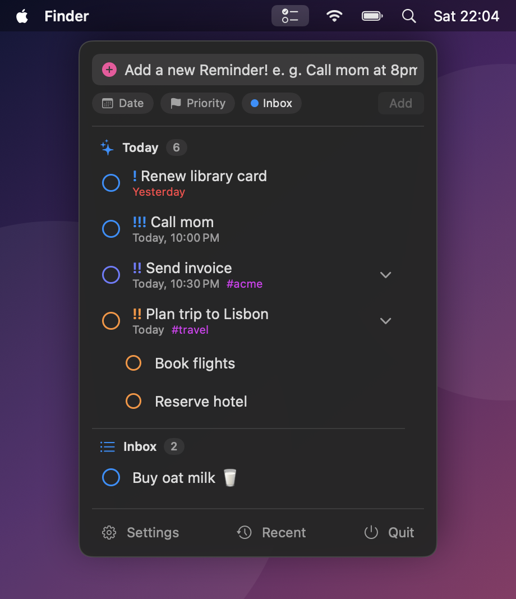
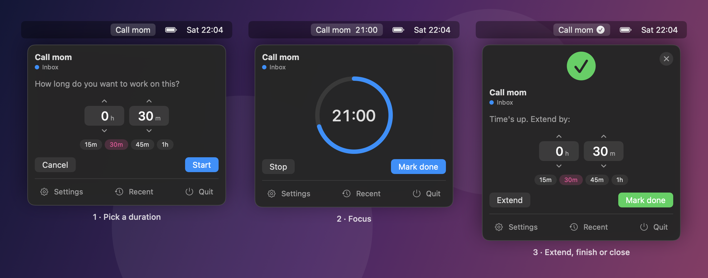
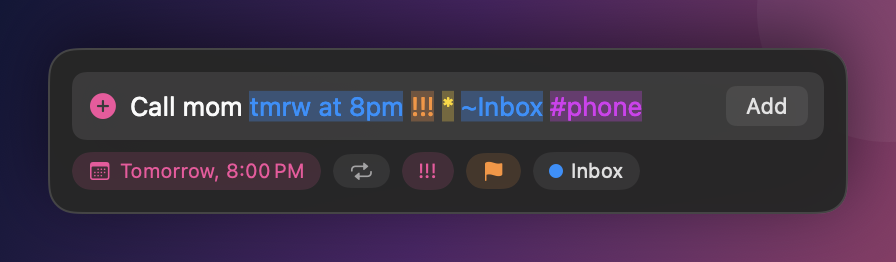
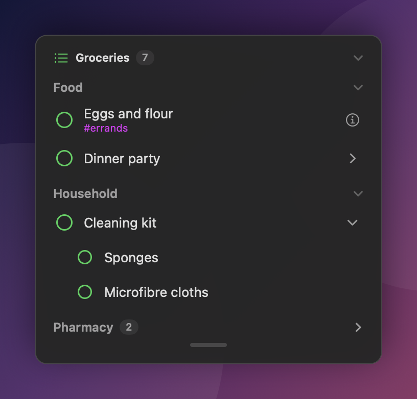
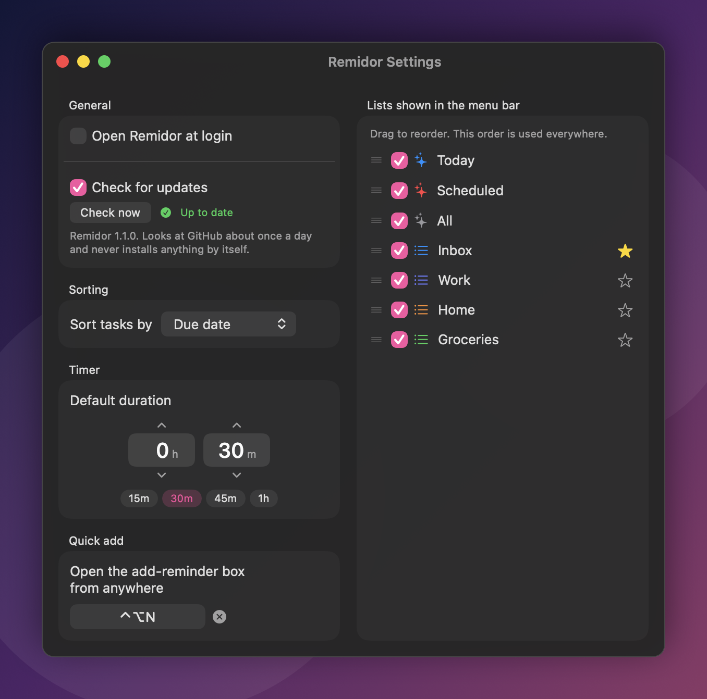

# Remidor


A menu bar companion for the macOS **Reminders** app. See what's open at a glance, add reminders in plain language, and focus on one task at a time with a built-in timer.

<p align="center">
  
</p>

**[Website](https://n9inee.github.io/Remidor/)** · **[Download](../../releases/latest)** · **[Demo video](docs/remidor-demo.mp4)**

> The screenshots are mockups, rendered from Remidor's real views with invented sample data.

## What it does

- **Dropdown.** Your open reminders, grouped by list, with Today, Scheduled, Flagged and All. Fold lists, list sections and sub-tasks, resize the window, and reorder lists in Settings.
- **Today, Next Up and Scheduled.** Late reminders sit under a red **Overdue** title with a Reschedule button that moves them to today, tomorrow, the weekend or next week in one go. Today then splits into All-Day, Morning, Afternoon and Tonight, and Next Up and Scheduled get a title for each day. Turn on Next Up in Settings for everything late plus the days coming up, always whole days, until at least five reminders are due. On other lists, ⋯ or right-click → Reschedule Overdue does the same.
- **Lists and sections.** The + in the footer makes a list, and it shows up right away, empty or not. Point at a list's name for a + that adds a reminder and a ⋯ menu that adds a section or renames or deletes the list. On Today, Flagged and All the + adds to your default list, already dated today or flagged. Sections come first, then the reminders that are in none. Drag lists and section headings to reorder them, and drop a reminder on a heading to move it there. Sorting stays inside each section, as in Reminders.
- **Sorting.** By due date, priority, title, creation date or **Manual**, which is the order you made in the Reminders app. Set it for all lists or for each list on its own (right-click a list's name → Sort By), and "Use for every list" in Settings drops the individual ones. Sub-tasks follow their list's order. Reordering one by hand puts that parent's sub-tasks in manual order, and right-click → Sort Sub-tasks changes it again.
- **Quick add.** Type "call mom tmrw at 8pm !!!" and the date, priority, list and tags are picked out for you (see below).
- **Edit in place.** Right-click a reminder → Edit, and change it with everything the quick-add box understands. Add Sub-task, and Add Reminder on a list, a section or a smart list, open that same box in place.
- **Drag and drop.** Drag a reminder to reorder it (the list switches to manual), onto another reminder to make it a sub-task, onto another list to move it, onto Flagged to flag it, or onto Today to make it due today. Drag a sub-task out the same way to take it out of its parent. Esc cancels a drag, and so does dropping anywhere that doesn't light up.
- **Focus timer.** Click a task, pick how long, and watch the countdown in the menu bar. Extend it or check the task off when time is up.
- **Shortcuts.** **⌥Space** opens a floating box from anywhere to add a reminder, or to find one and check it off (**⇧↩**). Tasks are grouped like the dropdown, and an ⓘ opens a task's details. **⇧⌥O** opens the Reminders app. Both can be changed in Settings.
- **Undo.** Checked something off by accident? Use the banner, **⌘Z**, or the Recent menu. Checking off a parent checks off its sub-tasks, and undo brings them back.
- **Week and weekend.** The date choices include Weekend and Next Week. They land on the days you pick in Settings, Monday and Saturday unless you change them.
- **Right-click menu.** Open, Edit, Add Sub-task, Date, Priority, Flag, List, Sort Sub-tasks, Move Up, Move Down, Details and Delete. A list's name has its own: New Section, Rename, Sort By and Delete.

<p align="center">
  
</p>

## Quick add

Type naturally and Remidor highlights what it understood as you go:

| Type | Examples | Result |
| --- | --- | --- |
| Date and time | `tomorrow 5pm`, `tmrw at 8`, `fri`, `in 20 min`, `in two weeks`, `in a month`, `end of month`, `weekend`, `next week` | Due date, with an alert when a time is given |
| Repeat | `every sunday`, `ev day`, `every 2 weeks`, `every mon and thu`, `every other tue`, `every weekday` | Repeats, starting on the next matching day |
| Priority | `!` `!!` `!!!` | Low, medium, high |
| Flag | `*` | Flags the reminder |
| List | `~Work`, `~"My List"` | Adds to that list |
| Tag | `#errands` | Added to the title and highlighted |

A bare hour after `at` is read as 1–6 → pm, 7–11 → am and 12 → noon, so `at 8` means 8 am. Add `am` or `pm` to be explicit. Every piece also has a button, typing `~`, `#` or `*` suggests lists, tags and the flag, and **Tab** turns what was typed into chips. **Return** adds the reminder. New reminders go to the list you starred in Settings, otherwise to **Inbox**, otherwise to your default list.

<p align="center">
  
</p>

<p align="center">
  
  &nbsp;
  
</p>

## Install

Remidor needs **macOS 14 (Sonoma) or later** and runs on Apple Silicon and Intel Macs.

1. Get `Remidor-….zip` from the [latest release](../../releases/latest) and unzip it.
2. Drag **Remidor.app** into your Applications folder and open it.
3. macOS will say it can't verify the app, because Remidor isn't notarized by Apple (that needs a paid developer account). Go to **System Settings → Privacy & Security**, scroll down and click **Open Anyway**. You only do this once per version. Or, in the Terminal:

   ```bash
   xattr -dr com.apple.quarantine /Applications/Remidor.app
   ```

4. When macOS asks for access to your reminders, choose *Allow*.

Remidor checks GitHub about once a day for a newer release and shows a banner in the dropdown when there is one. It never downloads or installs anything by itself. You can turn the check off in Settings.

### Build from source

Open `Remidor.xcodeproj` in Xcode 16 or later. Reminders access needs a signed build, so give it your own team: create `Config/Local.xcconfig` (git ignores it) with `DEVELOPMENT_TEAM = YOURTEAMID`. Then run. Releases are built by GitHub Actions when you push a version tag like `v1.2.3`.

Run the tests with ⌘U in Xcode, or:

```bash
xcodebuild test -project Remidor.xcodeproj -scheme Remidor -only-testing:RemidorTests
```

## Privacy

Everything stays on your Mac. Remidor reads and changes reminders through Apple's EventKit and has no analytics. The only network request is the optional update check, which asks GitHub for the latest release and sends only the app's name and version. It runs in the App Sandbox with access to Reminders and the network (for that check) as its only extra permissions.

## Good to know

- **Sub-tasks, tags, flags, manual order and sections** aren't part of EventKit's public API. Remidor reads them through undocumented fields (see [`ReminderKit.swift`](Remidor/Model/ReminderKit.swift)) and writes flags, order and sub-tasks through the same internal save request EventKit uses. If macOS ever changes them, those features quietly switch off and everything else keeps working. Sections are managed through the same hidden layer, so they can be added, renamed, reordered, deleted and filled by dragging, and deleting one keeps its reminders.
- **Smart lists** aren't exposed to other apps, so Today, Scheduled and All are rebuilt from due dates. Flagged uses the real flags.
- **Tags on new reminders** stay plain text in the title, because apps can't create real tags.
- **Repeating tasks can't be undone** after checking them off, and **deleting is permanent**.

Made by **n9ine**.
