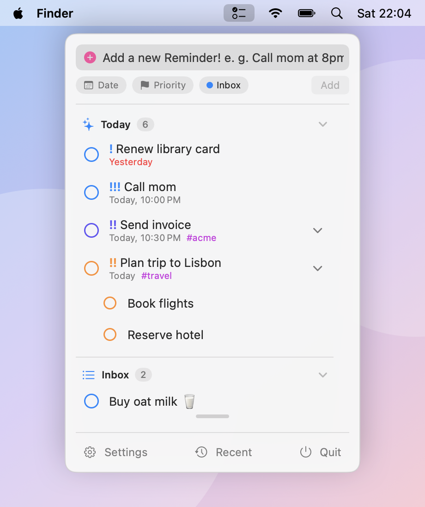
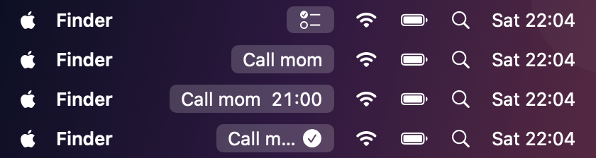
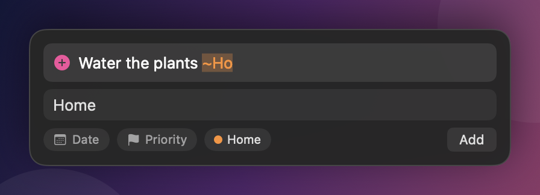
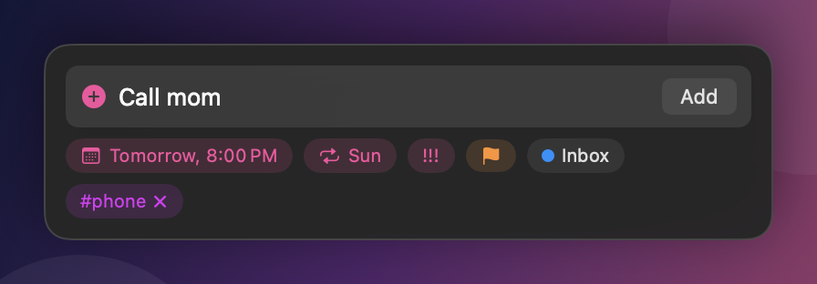
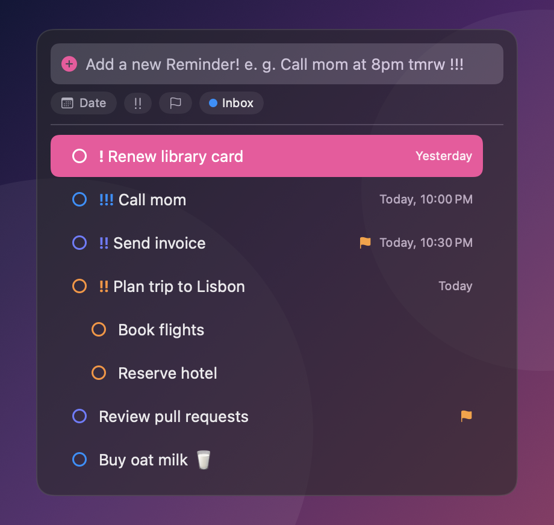
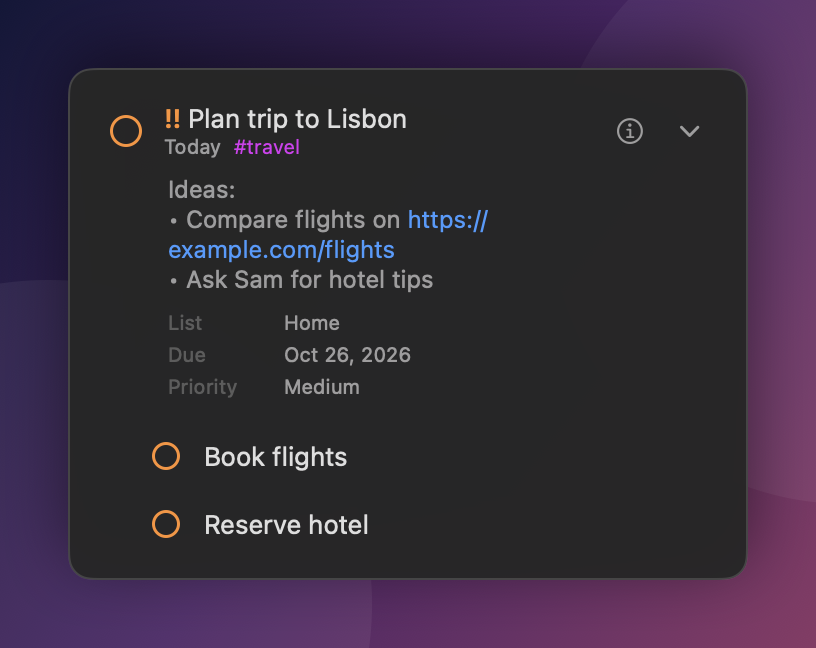
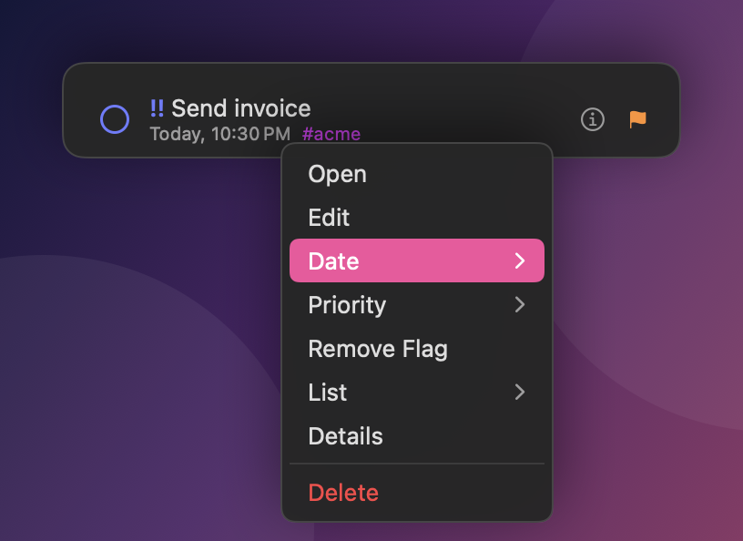
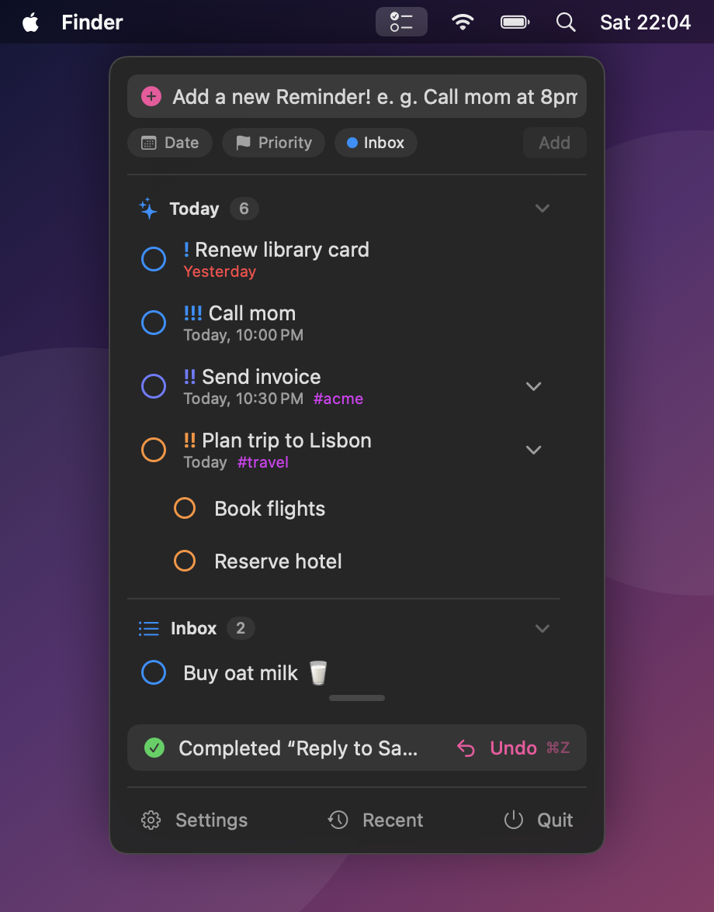
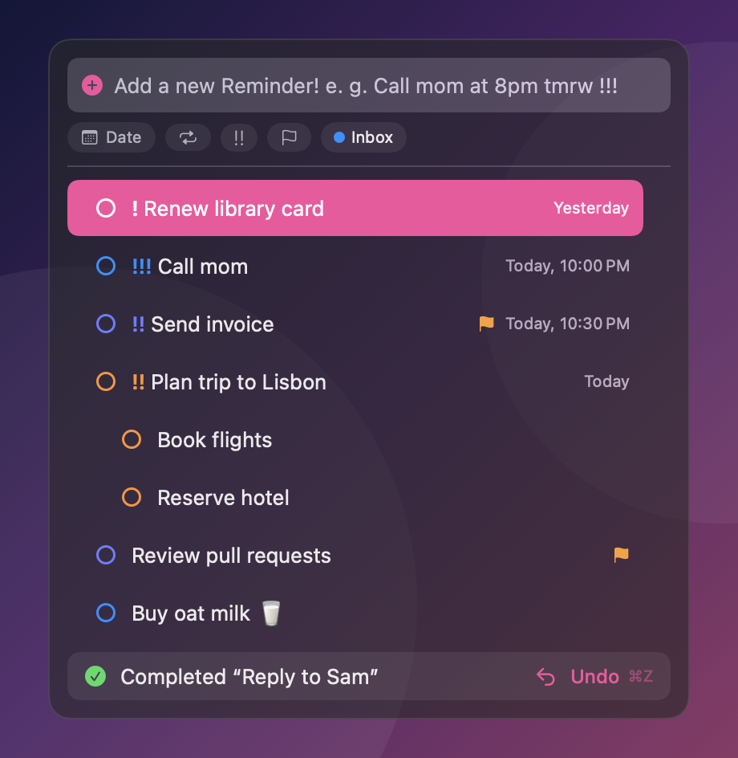
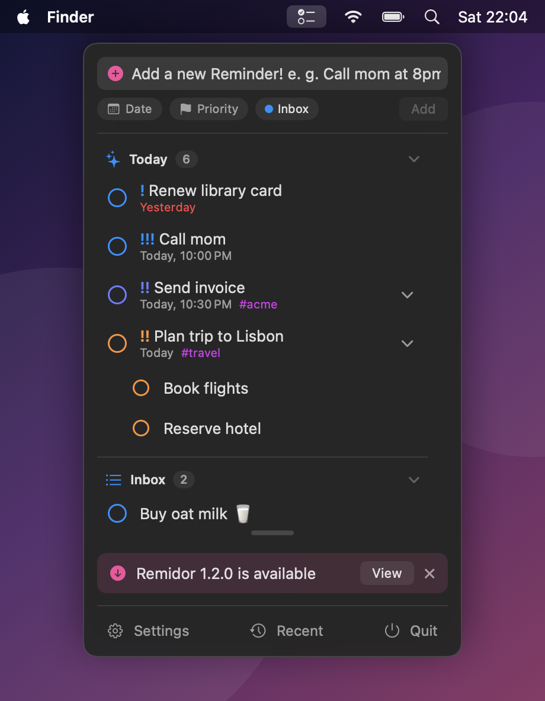

# Remidor

A menu bar companion for the macOS **Reminders** app. See what's open at a glance, add reminders in plain language, and focus on one task at a time with a built-in timer. It checks things off in Reminders when you're done.

<p align="center">
  
</p>

> The screenshots in this README are mockups, rendered from Remidor's real views with invented sample data.

## Features

- [Menu bar dropdown](#menu-bar-dropdown)
- [Focus timer](#focus-timer)
- [Quick add with natural language](#quick-add)
- [Global shortcut and quick select](#global-shortcut-and-quick-select)
- [Sub-tasks, tags and details](#sub-tasks-tags-and-details)
- [Right-click menu](#right-click-menu)
- [Undo](#undo)
- [Settings](#settings)

### Menu bar dropdown

Click the checklist icon to see your open reminders, grouped by list with a divider and a count for each. Lists use their Reminders colour, priorities show as `!`, `!!` and `!!!`, and overdue dates turn red. The list refreshes when you open it, whenever Reminders changes and every minute, so it stays in step with the Reminders app (and with iCloud).

- **Smart lists.** Today, Scheduled and All are available alongside your own lists. Today and Scheduled always sort by due date and time first, then priority.
- **Sorting.** Everything else sorts by due date, priority, title or creation date, whichever you pick in Settings.
- **Resizable.** The list is only as tall as it needs to be, so folding every list leaves no scroll bar. Drag the small handle under the list to make it taller or shorter. Double-click it to reset. Remidor remembers the height.
- **Collapsible lists.** Click a list's header to fold it shut or open it again. Which lists are folded is remembered between launches.
- **List order.** Drag lists into any order in Settings. That order is used everywhere: the dropdown, the list menus and the quick-select box.
- **Light and dark.** Follows your system appearance.

<p align="center">
  
</p>

### Focus timer

Click a task to start working on it.

1. The menu bar icon turns into the task's title and you choose how long to work. The hour and minute boxes step in 15-minute increments, or you can type a value or tap a preset (15m, 30m, 45m, 1h). The default is 30 minutes.
2. A visible countdown runs in the menu bar next to the title.
3. When time is up, the menu bar shows the title with a checkmark. Open it to extend by another stretch, mark the task done (it's checked off in Reminders and disappears from the list) or close the panel with the ✕ without doing either.

<p align="center">
  
</p>

<p align="center">
  
</p>

### Quick add

The box at the top of the dropdown adds reminders to any list, even lists you've hidden from the menu. Type naturally and Remidor highlights what it understood as you go:

| Type | Examples | Result |
| --- | --- | --- |
| Date and time | `tomorrow 5pm`, `tmrw at 8`, `fri`, `next fri`, `in 20 min`, `in 3 days` | Due date, with an alert when a time is given |
| Priority | `!` `!!` `!!!` | Low, medium, high |
| List | `~Work`, `~"My List"` | Adds to that list |
| Tag | `#errands` | Added to the title and highlighted |

Shorthand such as `tmr`, `tmrw`, `2moro`, `tonite` and `nxt` is understood. A bare hour after `at` is read as 1–6 → pm, 7–11 → am and 12 → noon, so `at 8` means 8 am and `at 4` means 4 pm. Add `am` or `pm` to be explicit.

<p align="center">
  
</p>

Everything has a button too (date with a calendar, priority, list), and the buttons always show what will be saved. A typed value wins over a button choice, and the other way round.

- **Autocomplete.** Typing `~` or `#` suggests your lists and tags. Click a suggestion or press Tab to accept it.
- **Tab turns text into chips.** Pressing Tab accepts the open suggestion and moves everything highlighted (date, priority, list and tags) out of the text box and onto the chips. Type a new date and press Tab again to replace the old one.
- **Return does the same, then adds.** It takes in the open suggestion and every highlighted piece, then adds the reminder.
- **Default list.** New reminders go to the list you starred in Settings, otherwise to **Inbox** if you have one, otherwise to your Reminders default list.

<p align="center">
  
  &nbsp;
  
</p>

### Global shortcut and quick select

Press **⌃⌥N** from anywhere (you can change it in Settings) to open a floating box, Spotlight-style, over whatever you're doing.

- Start typing to add a reminder, exactly as in the dropdown. While you type, the first row is "Add …", so **Return** adds it.
- Your open tasks are listed underneath. Typing filters them, **↑ ↓** moves the highlight and **Return** on a task starts working on it, followed by choosing how long.
- **Check a task off** without leaving the box: click the circle in front of it, or press **⇧ Return** to complete the highlighted one. The list closes up and the next task takes its place.
- Esc, or a click anywhere else, closes it.

<p align="center">
  
</p>

### Sub-tasks, tags and details

Sub-tasks sit directly under their parent, indented, and Reminders' own tags show under the title in purple. A chevron expands any row to show the notes (links are clickable), the URL, tags and key facts such as list, due date, priority and creation date. Hovering a long title shows it in full.

<p align="center">
  
</p>

Click the circle in front of a task to complete it. Click anywhere else on the row to start the timer.

### Right-click menu

| Item | What it does |
| --- | --- |
| **Open** | Opens the task's list in the Reminders app |
| **List** | Moves the task to another list |
| **Details** | Expands the row |
| **Delete** | Deletes the reminder |

<p align="center">
  
</p>

### Undo

Completing a task shows a banner with an **Undo** button for ten seconds, both in the dropdown and in the shortcut box. Press **⌘Z** to undo too. Press it again to step back through earlier completions. While you're typing in the add box, ⌘Z keeps its usual job of undoing your typing. The footer's **Recent** menu keeps the last five completed tasks, so an accidental tick is easy to take back.

**Repeating tasks can't be undone here.** Completing one in Reminders keeps the original, moves it to its next date and logs a separate completed copy, so there is nothing safe to un-complete. Remidor shows a "Repeats" note instead of an Undo button. To take one back, use the Reminders app.

<p align="center">
  
  &nbsp;
  
</p>

### Settings

<p align="center">
  
</p>

- **General.** *Check for updates* looks at GitHub about once a day and shows a banner in the dropdown when a newer release exists (see [Updating](#updating)). *Open Remidor at login* starts the app when you log in. It also appears under System Settings → General → Login Items, and if macOS needs your approval the switch shows a button that opens that pane.
- **Lists.** Choose which lists (and smart lists) appear, drag to reorder, and click the star to make a list the default for new reminders. Click the filled star again to go back to automatic.
- **Sorting.** Due date, priority, title or creation date.
- **Timer.** The default duration.
- **Quick add.** The global shortcut. Remidor warns you if macOS or another app already uses the combination you chose.

All settings are saved between launches.

## Install

### Download

Remidor needs **macOS 14 (Sonoma) or later** and runs on Apple Silicon and Intel Macs.

1. Get `Remidor-….zip` from the [latest release](../../releases/latest) and unzip it.
2. Drag **Remidor.app** into your Applications folder and open it.
3. macOS will say it can't verify the app, because Remidor isn't notarized by Apple. That requires a paid developer account, and the app is free and open source. To open it anyway, go to **System Settings → Privacy & Security**, scroll down and click **Open Anyway** next to the Remidor message, then confirm. You only have to do this once.
4. When macOS asks for access to your reminders, choose *Allow*. If you decline, the dropdown shows a button that opens the right Privacy settings pane.

If you prefer the Terminal, this removes the download flag instead:

```bash
xattr -dr com.apple.quarantine /Applications/Remidor.app
```

Each release also has a `.sha256` file if you'd like to check the download.

### Updating

Remidor checks GitHub about once a day for a newer release. When there is one, the dropdown shows a banner with a **View** button that opens the release page. Nothing is downloaded or installed automatically: download the new zip, replace the app in your Applications folder and open it. Your settings are kept, because macOS stores them by the app's bundle ID and not inside the app file. You can turn the check off, or run it by hand, in Settings → General.

<p align="center">
  
</p>

Since each release is a new build to macOS, expect the Open Anyway step and the Reminders prompt once more after an update.

### Build from source

Remidor is built with SwiftUI and has no dependencies.

1. Open `Remidor.xcodeproj` in Xcode.
2. Give the build your own signing team. A free Apple ID is enough, and Reminders access needs a signed build. The simplest way is to create `Config/Local.xcconfig` (git ignores it) containing `DEVELOPMENT_TEAM = YOURTEAMID`. You can also choose the team under *Signing & Capabilities*, but that writes your team ID into the project file. Signing with a real team also means macOS asks for Reminders access only once. Without one, it asks again after every build.
3. Run. Allow access to your reminders when macOS asks.

Requires macOS 14 (Sonoma) or later and Xcode 16 or later. It runs on both Apple Silicon and Intel Macs.

Remidor is a menu bar app and has no Dock icon. Use **Quit** in the dropdown to close it.

### Publishing a release

Releases are built by GitHub Actions. Push a version tag and the workflow in `.github/workflows/release.yml` runs the tests, builds the app, signs it ad hoc and attaches the zip to a new release. The app's version number comes from the tag, so `v1.2.3` builds Remidor 1.2.3:

```bash
git tag v1.0.0 && git push origin v1.0.0
```

## Privacy

Everything stays on your Mac. Remidor reads and changes reminders through Apple's EventKit framework and has no analytics. The only network request it makes is the optional update check, which asks GitHub for the latest release of this project. The request carries only the app's name and version, keeps no cookies or cache, and says nothing about you or your reminders. GitHub sees your IP address, as any website does. You can turn it off in Settings. Remidor runs in the App Sandbox, with access to Reminders and to the network (for that check) as its only extra permissions.

## How it works, and its limits

- **Sub-tasks and tags** aren't part of EventKit's public API. Remidor reads them through undocumented fields on each reminder (see [`ReminderKit.swift`](Remidor/Model/ReminderKit.swift)). If macOS ever changes them, sub-tasks show as ordinary rows and tags are hidden, and nothing else breaks.
- **Smart lists.** Apple doesn't expose Today, Scheduled or Flagged to other apps. Remidor recreates Today, Scheduled and All from due dates. Flagged isn't available.
- **Tags on new reminders.** Apps can't create real Reminders tags, so a `#tag` added in the quick-add box becomes plain text in the title. Existing tags are shown properly.
- **Opening a list.** "Open" uses Reminders' internal link format and falls back to simply opening the app if that doesn't work.
- **Delete is permanent.** There's no undo for deleting a reminder, only for completing one.

## Project layout

```
Remidor/
├── App/        app entry point and the global-shortcut hookup
├── Model/      TaskModel (EventKit, timer, undo), value types, sorting, ReminderKit bridge
├── Menu/       the dropdown: list, rows, timer screens, formatting
├── QuickAdd/   natural-language parser, draft state, the box, the floating panel
├── Settings/   the Settings window and shortcut recorder
├── Shared/     DurationPicker
└── System/     the system-wide hotkey
```

## Tests

The natural-language parser, the ordering rules (including sub-task nesting) and the formatting helpers have unit tests in `RemidorTests`. Run them with ⌘U in Xcode, or:

```bash
xcodebuild test -project Remidor.xcodeproj -scheme Remidor -only-testing:RemidorTests
```

## Author

Made by **n9ine**.
